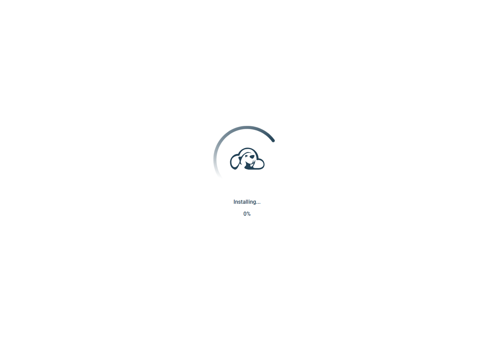
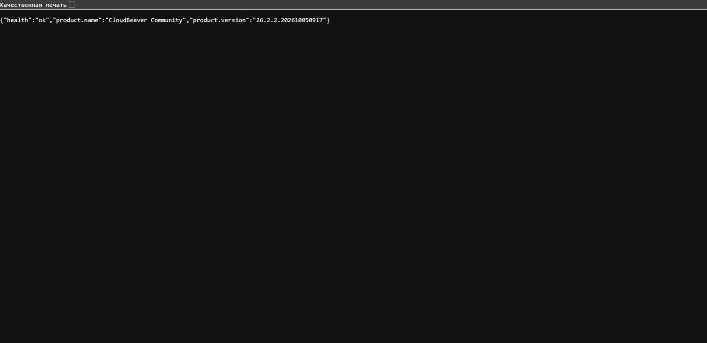

# CloudBeaver

Работа выполнена по [заданию преподавателя](https://github.com/rurewa/imfua/blob/main/content/Docker/DockerCompose/CloudBeaver.md). Используется официальный образ CloudBeaver Community; рабочее пространство хранится в именованном томе.

## Запуск

```powershell
docker compose config
docker compose up -d
```

Интерфейс: <http://localhost:8978>. При первом открытии CloudBeaver предлагает локальную первоначальную настройку. Остановка с сохранением рабочего пространства: `docker compose stop`.

## Результат проверки

- `docker compose config --quiet` выполнена без ошибок.
- Jetty запущен на внутреннем порту 8978, критических ошибок в логах нет.
- Главная страница вернула HTTP 200.
- Endpoint `/status` вернул `health: ok`, продукт CloudBeaver Community версии 26.2.2.202610050917.
- Контейнер остановлен обычной командой Compose; рабочий том сохранён.

**Статус: выполнено.**

## Скриншоты выполнения

Оба снимка настоящие и сделаны в изолированном браузере. Headless-клиент остался на встроенном экране установки, поэтому отдельно зафиксирован серверный endpoint `/status`.





`/status` подтвердил `health: ok`, продукт CloudBeaver Community и версию 26.2.2.202610050917. Секреты и учётные данные отсутствуют.
