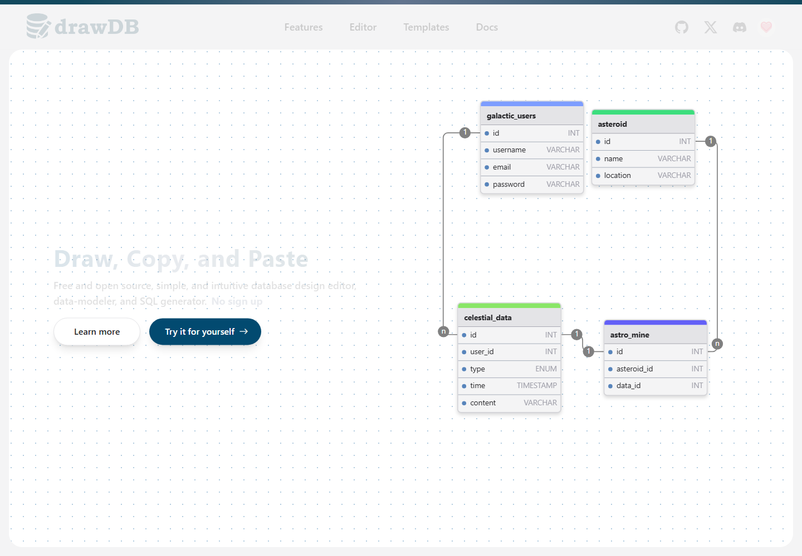

# drawDB

Работа выполнена по [заданию преподавателя](https://github.com/rurewa/imfua/blob/main/content/Docker/DockerCompose/drawDB.md) с актуальным официальным образом `ghcr.io/drawdb-io/drawdb:latest`.

## Запуск

```powershell
docker compose config
docker compose up -d
```

Редактор: <http://localhost:5173>. Для остановки: `docker compose stop`.

## Результат проверки

- `docker compose config --quiet` выполнена без ошибок.
- Официальный образ загружен из GitHub Container Registry; первый сетевой тайм-аут устранён повторной загрузкой.
- nginx внутри контейнера запущен без критических ошибок.
- Главная страница проверена с хоста и из контейнера, получен HTTP 200.
- Контейнер остановлен с кодом 0.

**Статус: выполнено.**

## Скриншоты выполнения

Настоящий снимок работающего редактора сделан в изолированном браузере. На холсте отображается демонстрационная связанная схема самого приложения.



Команда `docker compose ps` подтвердила сервис `Up`, а HTTP-проверка вернула 200.
