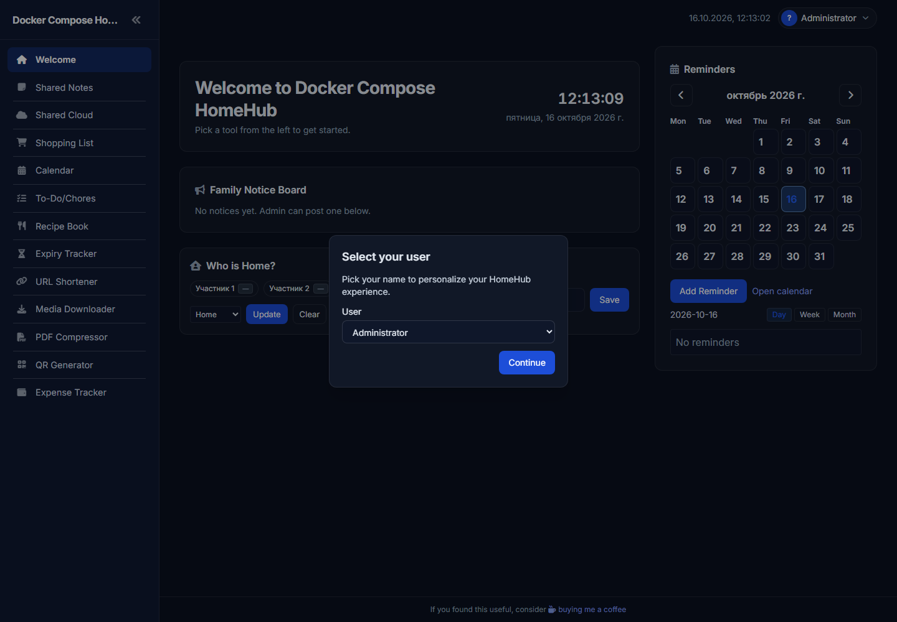

# Homehub

Работа выполнена по [заданию преподавателя](https://github.com/rurewa/imfua/blob/main/content/Docker/DockerCompose/Homehub.md) с официальным образом `ghcr.io/surajverma/homehub:latest`. В `config.yml` включены основные учебные функции и заданы только обезличенные участники.

## Запуск

```powershell
$env:DC_HOMEHUB_SECRET_KEY = Read-Host 'Homehub local secret key'
docker compose config
docker compose up -d
```

Панель: <http://localhost:5000>. Каталоги с загружаемыми файлами и локальной БД исключены из Git. Остановка: `docker compose stop`.

## Результат проверки

- `docker compose config --quiet` выполнена без ошибок.
- Gunicorn запустился, контейнер перешёл в состояние `healthy`.
- `/healthz` и главная страница вернули HTTP 200.
- На странице отображаются название `Docker Compose HomeHub` и два обезличенных учебных участника из `config.yml`.
- Контейнер остановлен с кодом 0, локальные данные сохранены.

**Статус: выполнено.**

## Скриншоты выполнения

Настоящий снимок главной панели сделан в изолированном браузере. В интерфейсе присутствуют только обезличенные учебные участники.



Команда `docker compose ps` подтвердила состояние `healthy`, endpoint `/healthz` вернул `{"ok":true}`.
