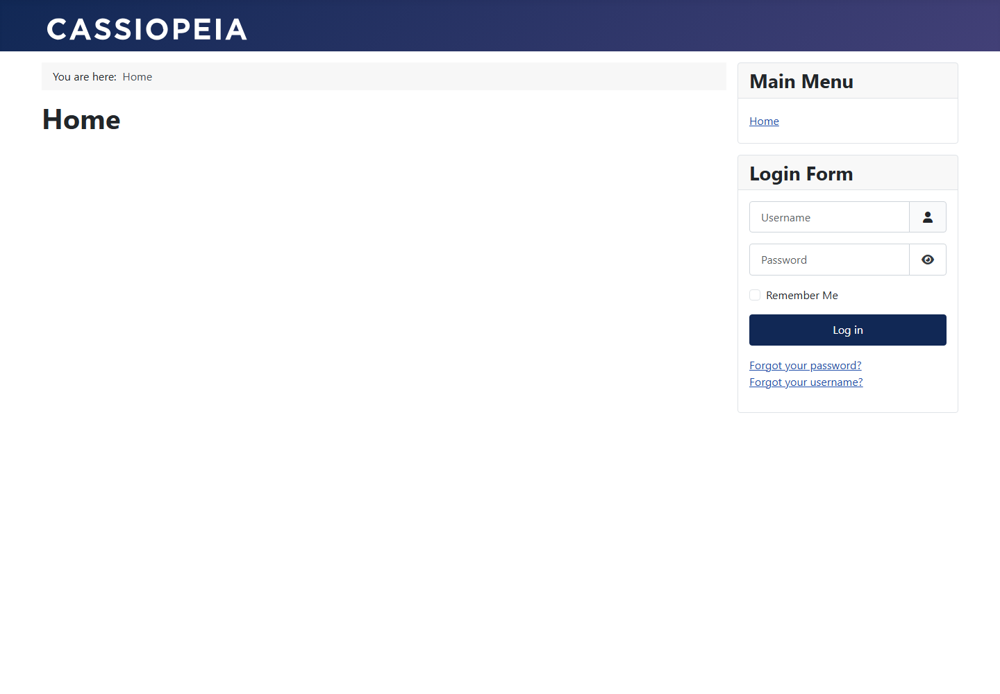

# Joomla

Работа выполнена по [заданию преподавателя](https://github.com/rurewa/imfua/blob/main/content/Docker/DockerCompose/joomla.md). Официальный образ Joomla автоматически устанавливает CMS в связке с MariaDB 11.5.2; состояние обоих сервисов сохраняется в именованных томах.

## Запуск

```powershell
$env:DC_JOOMLA_DB_PASSWORD = Read-Host 'Joomla database password'
$env:DC_JOOMLA_ADMIN_PASSWORD = Read-Host 'Joomla administrator password'
docker compose config
docker compose up -d
```

Сайт: <http://localhost:8082>, панель: <http://localhost:8082/administrator/>. Остановка: `docker compose stop`.

## Результат проверки

- `docker compose config --quiet` выполнена без ошибок.
- MariaDB перешла в состояние `healthy`.
- Логи Joomla подтверждают успешную проверку требований, соединение с БД, заполнение базы, запись конфигурации и удаление каталога установки.
- В базе создано 76 таблиц.
- Главная страница и панель администратора вернули HTTP 200.
- Оба контейнера остановлены с кодом 0, тома сохранены.

**Статус: выполнено.**

## Скриншоты выполнения

Настоящий снимок публичной главной страницы сделан в изолированном браузере. Поля формы входа пусты.



Команда `docker compose ps` подтвердила MariaDB `healthy` и Joomla `Up`; проверка базы вернула 76 таблиц.
