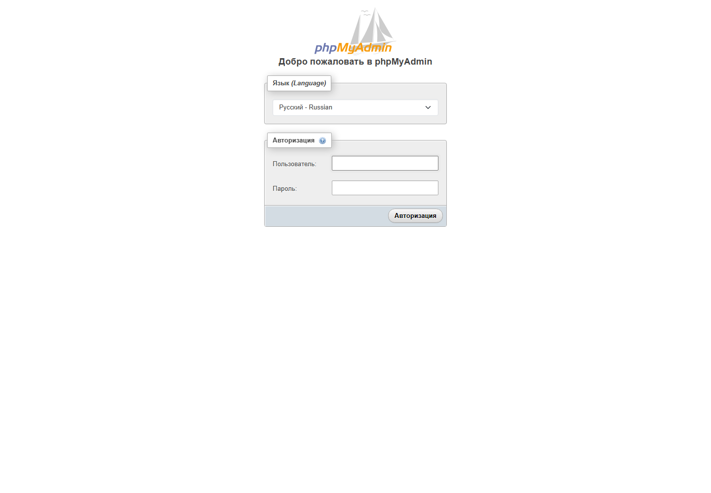

# MySQL + phpMyAdmin

Работа выполнена по [заданию преподавателя](https://github.com/rurewa/imfua/blob/main/content/Docker/DockerCompose/mySQLphpMyAdmin.md). Compose запускает MySQL 8.0 и phpMyAdmin в общей сети; данные MySQL находятся в именованном томе.

## Запуск

В PowerShell задайте собственные локальные тестовые пароли и запустите проект:

```powershell
$env:DC_MYSQL_ROOT_PASSWORD = Read-Host 'MySQL root password'
$env:DC_MYSQL_PASSWORD = Read-Host 'MySQL lab_user password'
docker compose config
docker compose up -d
```

Интерфейс: <http://localhost:8083>. MySQL опубликован только на `127.0.0.1:3306`. Остановка без удаления тома: `docker compose stop`.

## Результат проверки

- `docker compose config --quiet` выполнена без ошибок.
- Контейнер MySQL перешёл в состояние `healthy`; фактическая версия сервера — 8.0.46.
- В таблицу `compose_check` записано и прочитано значение `mysql-ok`.
- Страница phpMyAdmin вернула HTTP 200; в логах нет критических ошибок.
- После проверки оба контейнера остановлены с кодом 0, том сохранён.

**Статус: выполнено.**

## Скриншоты выполнения

Настоящий снимок страницы входа сделан в изолированном браузере. Поля учётных данных оставлены пустыми; пароли не отображаются.



Состояние контейнеров дополнительно подтверждено командой `docker compose ps`: MySQL — `healthy`, phpMyAdmin — `Up`. SQL-проверка вернула строку `1 | mysql-ok`.
