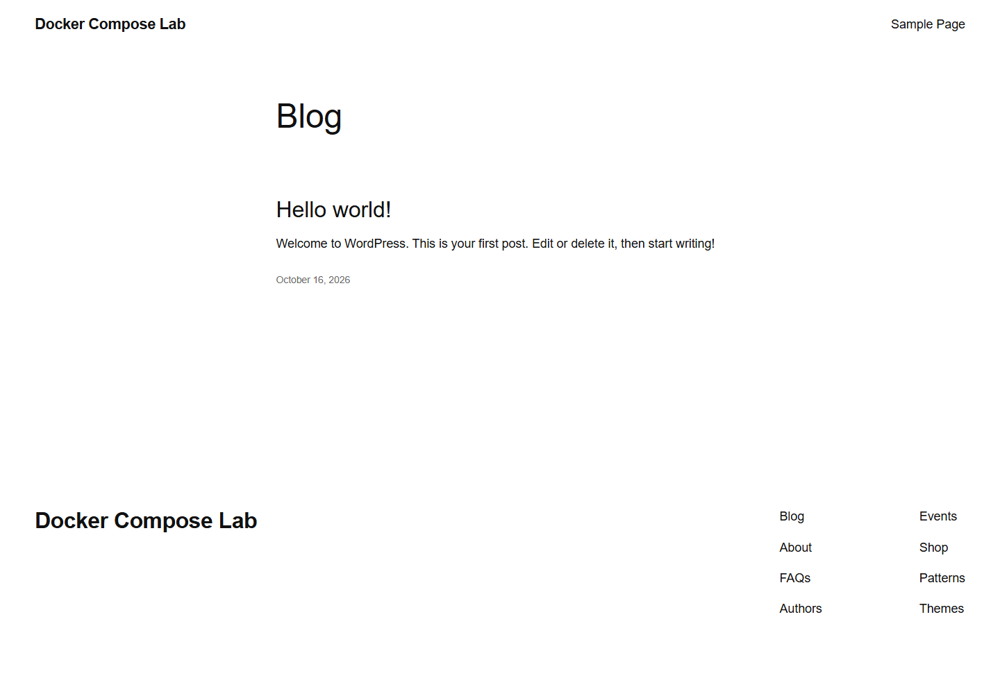

# WordPress

Работа выполнена по [заданию преподавателя](https://github.com/rurewa/imfua/blob/main/content/Docker/DockerCompose/WordPress.md). Сайт WordPress работает с отдельным MySQL 8.0; официальный WP-CLI вынесен в профиль `tools`.

## Запуск

```powershell
$env:DC_WORDPRESS_DB_PASSWORD = Read-Host 'WordPress database password'
docker compose config
docker compose up -d
```

Сайт: <http://localhost:8081>, вход: <http://localhost:8081/wp-login.php>. Остановка без удаления сайта и БД: `docker compose stop`.

## Результат проверки

- `docker compose config --quiet` выполнена без ошибок.
- MySQL перешёл в состояние `healthy`, WordPress запущен через официальный образ.
- Установка сайта `Docker Compose Lab` завершена с помощью WP-CLI 2.12.0.
- Через WP-CLI подтверждён `siteurl` — `http://localhost:8081`.
- В MySQL присутствует один учебный пользователь WordPress.
- Главная и форма входа вернули HTTP 200; права каталога `wp-content` приведены к пользователю веб-сервера.
- Контейнеры остановлены с кодом 0, оба тома сохранены.

**Статус: выполнено.**

## Скриншоты выполнения

Настоящий снимок публичной главной страницы сделан в изолированном браузере.



Команда `docker compose ps` подтвердила MySQL `healthy` и WordPress `Up`; запрос к БД вернул корректный `siteurl` и одного учебного пользователя.
