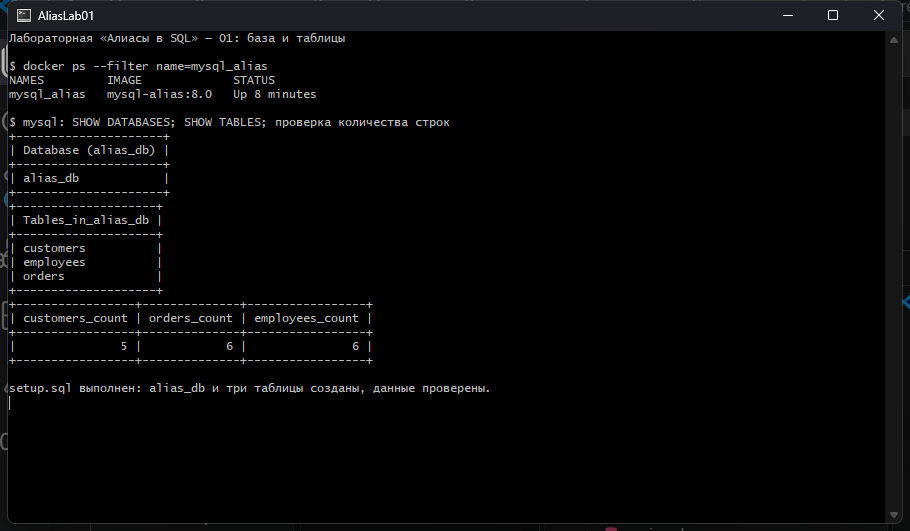
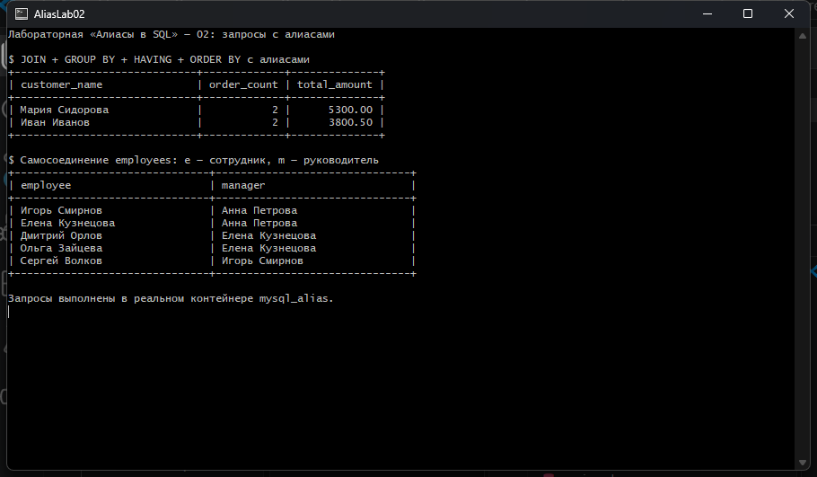
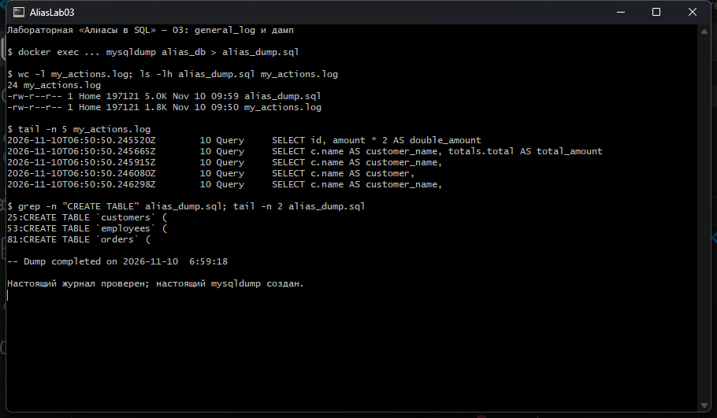

# Лабораторная работа «Алиасы в SQL»

## Цель работы

Освоить алиасы таблиц и столбцов в MySQL, применить их в соединениях, агрегатных запросах и подзапросах, а также настроить журналирование SQL-действий и создать восстанавливаемый дамп базы данных.

Работа выполнена по [инструкции преподавателя](https://github.com/rurewa/imfua/blob/main/content/Courses/Basics_database_design/content/bd/Aliases.md) в существующем репозитории, в отдельном контейнере `mysql_alias` на базе официального образа MySQL 8.0.

## Состав лабораторной

| Файл | Назначение |
| --- | --- |
| [`my.cnf`](my.cnf) | Настройки UTF-8 и файлового `general_log` |
| [`setup.sql`](setup.sql) | Создание `alias_db`, таблиц и исходных данных |
| [`queries.sql`](queries.sql) | Запросы с алиасами, `JOIN`, `GROUP BY`, `HAVING`, `ORDER BY` и подзапросами |
| [`alias_dump.sql`](alias_dump.sql) | Настоящий дамп `alias_db`, созданный через `mysqldump` |
| [`my_actions.log`](my_actions.log) | Отфильтрованный журнал SQL-действий из MySQL `general_log` |
| [`setup-output.txt`](setup-output.txt) | Реальный вывод создания и заполнения таблиц |
| [`queries-output.txt`](queries-output.txt) | Реальные результаты запросов с алиасами |
| [`verification-output.txt`](verification-output.txt) | Проверка версии, настроек, количества строк и восстановления дампа |
| [`Dockerfile`](Dockerfile) | Образ на базе `mysql:8.0`, добавляющий `my.cnf` с безопасными правами |
| [`run_lab.sh`](run_lab.sh) | Воспроизводимый запуск лабораторной через Git Bash и Docker CLI |
| [`verify_lab.sh`](verify_lab.sh) | Проверка рабочей базы и тестовое восстановление дампа |

## Ход выполнения

1. Создан `my.cnf` с кодировкой `utf8mb4`, сопоставлением `utf8mb4_unicode_ci`, включённым `general_log` и выводом журнала в файл `/var/lib/mysql/general.log`.
2. На базе официального `mysql:8.0` собран локальный образ `mysql-alias:8.0` и запущен изолированный контейнер `mysql_alias` с отдельным volume `mysql_alias_data`.
3. Создана база `alias_db` и таблицы `customers`, `orders`, `employees` со связями, указанными в задании.
4. В таблицы добавлены все данные из задания: 5 клиентов, 6 заказов и 6 сотрудников.
5. Выполнены запросы с алиасами таблиц и столбцов, обычным и рекурсивным `JOIN`, агрегатами, `GROUP BY`, `HAVING`, `ORDER BY`, производной таблицей и коррелированным подзапросом.
6. Стартовые системные сообщения удалены из журнала до выполнения лабораторных SQL-команд. После запросов логирование отключено, а пользовательские SQL-действия экспортированы в `my_actions.log` по фильтру преподавателя.
7. База экспортирована настоящей командой `mysqldump` в `alias_dump.sql`.
8. Дамп восстановлен во временную базу `alias_restore_check`: после восстановления получены те же 5 клиентов, 6 заказов и 6 сотрудников. Затем временная проверочная база удалена.

> Docker Desktop на Windows представляет bind-mounted конфигурационные файлы как доступные для записи всем пользователям. MySQL 8.0 из соображений безопасности игнорирует такой `my.cnf`. Поэтому файл с теми же настройками копируется в производный образ с правами `0444`; базовый образ остаётся официальным `mysql:8.0`.

## Примеры SQL-запросов

### Алиасы таблиц и столбцов, группировка и сортировка

```sql
SELECT c.name AS customer_name,
       COUNT(o.id) AS order_count,
       SUM(o.amount) AS total_amount
FROM customers AS c
JOIN orders AS o ON c.id = o.customer_id
GROUP BY c.id, c.name
HAVING total_amount > 1000
ORDER BY total_amount DESC;
```

Результат:

| customer_name | order_count | total_amount |
| --- | ---: | ---: |
| Мария Сидорова | 2 | 5300.00 |
| Иван Иванов | 2 | 3800.50 |

### Самосоединение таблицы сотрудников

```sql
SELECT e.name AS employee,
       m.name AS manager
FROM employees AS e
JOIN employees AS m ON e.manager_id = m.id;
```

Здесь `e` обозначает сотрудника, а `m` — его руководителя. Алиасы позволяют дважды использовать таблицу `employees` без неоднозначности.

### Алиас производной таблицы

```sql
SELECT c.name AS customer_name,
       totals.total AS total_amount
FROM customers AS c
JOIN (
    SELECT customer_id, SUM(amount) AS total
    FROM orders
    GROUP BY customer_id
) AS totals ON c.id = totals.customer_id
WHERE totals.total > 2000
ORDER BY total_amount DESC;
```

## Скриншоты выполнения

### 1. База данных, таблицы и проверка данных



### 2. Запросы с алиасами и реальные результаты



### 3. Проверка журнала и создание дампа



## Дамп и журнал действий

- [Открыть `alias_dump.sql`](alias_dump.sql)
- [Открыть `my_actions.log`](my_actions.log)

Дамп содержит определения всех трёх таблиц, внешние ключи и данные. Журнал содержит 24 отфильтрованных SQL-действия этой лабораторной и не содержит запросов к системным таблицам MySQL, паролей, токенов или данных других проектов.

## Результаты проверки

- MySQL: `8.0.46`.
- Контейнер: `mysql_alias`.
- База: `alias_db`.
- Настройки: `general_log_file = /var/lib/mysql/general.log`, `log_output = FILE`.
- Рабочая база: 5 клиентов, 6 заказов, 6 сотрудников.
- Восстановленная из дампа база: 5 клиентов, 6 заказов, 6 сотрудников.
- В дампе найдены три `CREATE TABLE`, три набора `INSERT INTO` и отметка успешного завершения `mysqldump`.
- Все три PNG-файла созданы из настоящего окна Git Bash с реальными командами и результатами.

## Вывод

В ходе работы были изучены алиасы таблиц и столбцов, устранение неоднозначности полей, самосоединение, алиасы агрегатов и производных таблиц. Запросы с `JOIN`, `GROUP BY`, `HAVING`, `ORDER BY` и подзапросами выполнены в MySQL 8.0 и проверены. Для воспроизводимости сохранены SQL-файлы, настоящий журнал действий, рабочий дамп базы и три подтверждающих скриншота.
