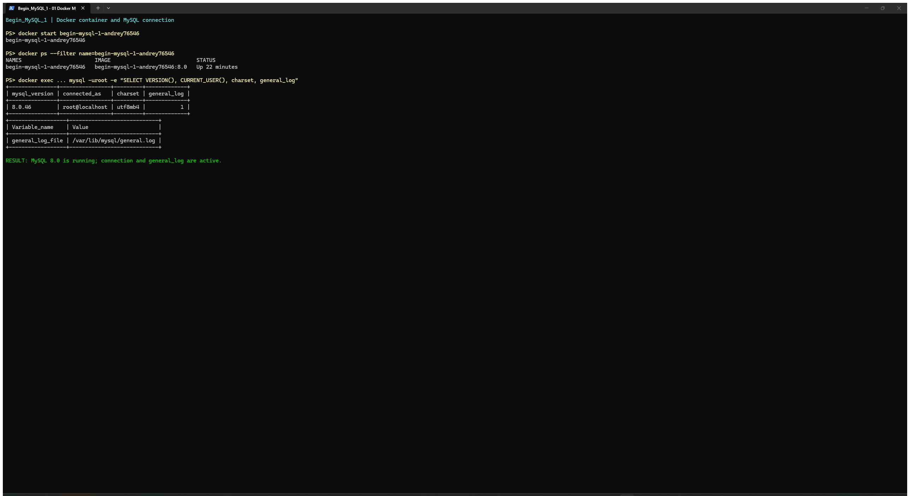
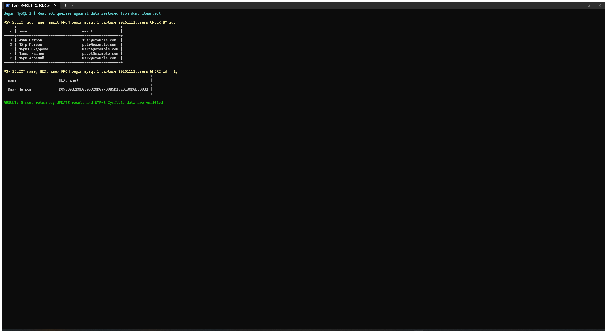
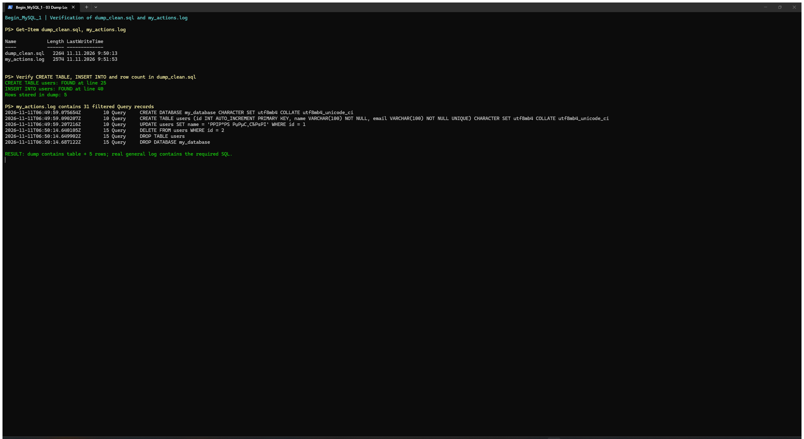

# Begin_MySQL_1 — интерактивная работа с MySQL в Docker

Лабораторная выполнена по [инструкции преподавателя](https://github.com/rurewa/imfua/blob/main/content/Courses/Basics_database_design/content/bd/Begin_MySQL_1.md).

## Цель

- запустить MySQL 8.0 в изолированном Docker-окружении;
- настроить UTF-8 и `general_log` через `my.cnf`;
- создать базу `my_database` и таблицу `users`;
- выполнить `INSERT`, `SELECT`, `UPDATE`, `DELETE`, `DROP TABLE` и `DROP DATABASE`;
- сохранить дамп до удаления базы;
- экспортировать настоящий журнал SQL-запросов с минимумом служебных строк.

## Изоляция и безопасность

Для лабораторной использованы только отдельные ресурсы:

- контейнер: `begin-mysql-1-andrey76546`;
- volume: `begin_mysql_1_andrey76546_data`;
- локальный образ: `begin-mysql-1-andrey76546:8.0`, собранный `FROM mysql:8.0`.

Глобальные команды очистки Docker (`prune`) не применялись. Другие контейнеры, volumes, базы и лабораторные не изменялись. Пароль `123` — исключительно учебное значение из задания, а не реальный секрет.

## Подготовка MySQL 8.0

На Windows bind-mounted конфигурация получает слишком широкие права, и MySQL игнорирует её как небезопасную. Поэтому [Dockerfile](./Dockerfile) копирует [my.cnf](./my.cnf) внутрь производного образа и задаёт файлу права `0644`:

```dockerfile
FROM mysql:8.0

COPY my.cnf /etc/mysql/conf.d/my.cnf
RUN chmod 0644 /etc/mysql/conf.d/my.cnf
```

Основные параметры `my.cnf`:

```ini
[mysqld]
character-set-server = utf8mb4
collation-server = utf8mb4_unicode_ci
general_log = 1
general_log_file = /var/lib/mysql/general.log
log_output = FILE
```

Сборка и запуск в Git Bash:

```bash
docker build -t begin-mysql-1-andrey76546:8.0 .
docker volume create begin_mysql_1_andrey76546_data
docker run --name begin-mysql-1-andrey76546 \
  -e MYSQL_ROOT_PASSWORD=123 \
  -e LANG=C.UTF-8 \
  -v begin_mysql_1_andrey76546_data:/var/lib/mysql \
  -d begin-mysql-1-andrey76546:8.0

docker exec -it begin-mysql-1-andrey76546 \
  mysql --default-character-set=utf8mb4 -uroot -p
```

Проверено: MySQL `8.0.46`, `character_set_server=utf8mb4`, `general_log=1`.

## SQL-операции

Полный набор команд находится в [sql/operations.sql](./sql/operations.sql), фактический вывод клиента — в [operations-output.txt](./operations-output.txt).

```sql
CREATE DATABASE my_database
  CHARACTER SET utf8mb4
  COLLATE utf8mb4_unicode_ci;
USE my_database;

CREATE TABLE users (
    id INT AUTO_INCREMENT PRIMARY KEY,
    name VARCHAR(100) NOT NULL,
    email VARCHAR(100) NOT NULL UNIQUE
) CHARACTER SET utf8mb4 COLLATE utf8mb4_unicode_ci;

INSERT INTO users (name, email) VALUES
  ('Иван Иванов', 'ivan@example.com'),
  ('Пётр Петров', 'petr@example.com'),
  ('Мария Сидорова', 'maria@example.com');

INSERT INTO users (name, email)
VALUES ('Павел Иванов', 'pavel@example.com');
INSERT INTO users (name, email)
VALUES ('Марк Аврелий', 'mark@example.com');

UPDATE users SET name = 'Иван Петров' WHERE id = 1;
SELECT * FROM users;
```

Перед созданием дампа таблица содержала пять строк. Запись `id=1` была изменена на `Иван Петров`; корректность кириллицы дополнительно проверена через `HEX(name)`.

## Дамп до удаления базы

Дамп создан до `DELETE` и `DROP`:

```bash
docker exec -e MYSQL_PWD=123 begin-mysql-1-andrey76546 \
  mysqldump -uroot \
  --set-gtid-purged=OFF \
  --single-transaction \
  my_database > dump_clean.sql
```

[dump_clean.sql](./dump_clean.sql) проверен: он содержит `CREATE TABLE users`, `INSERT INTO users` и все пять строк, включая `Иван Петров` и `Марк Аврелий`.

## DELETE и DROP

Команды удаления сохранены в [sql/cleanup.sql](./sql/cleanup.sql), фактический вывод — в [cleanup-output.txt](./cleanup-output.txt).

```sql
USE my_database;
SELECT * FROM users;
DELETE FROM users WHERE id = 2;
SELECT * FROM users;
DROP TABLE users;
SHOW TABLES;
DROP DATABASE my_database;
SHOW DATABASES;
```

После выполнения `SHOW DATABASES LIKE 'my_database'` не вернул строк: учебная база удалена после сохранения дампа.

## Экспорт general log

Файл `/var/lib/mysql/general.log` создан сервером благодаря `general_log=1`. Скрипт [export_log.sh](./export_log.sh) оставляет только учебные запросы непосредственно после поля `Query` и исключает служебные запросы клиента и `mysqldump`:

```bash
bash ./export_log.sh
```

Результат: [my_actions.log](./my_actions.log), 31 строка. В журнале присутствуют `CREATE DATABASE`, `CREATE TABLE`, все `INSERT`/`SELECT`, `UPDATE`, `DELETE`, `DROP TABLE` и `DROP DATABASE` с реальными временными метками и идентификаторами соединений.

После проверки выполнялись только команды управления учебным контейнером:

```bash
docker stop begin-mysql-1-andrey76546
docker start begin-mysql-1-andrey76546
```

## Скриншоты

Из-за неисправного VS Code CLI снимки сделаны в разрешённом запасном варианте — в настоящих окнах PowerShell. На них показан фактический вывод Docker CLI и MySQL; изображения не генерировались и не редактировались.

### 1. Запуск контейнера и подключение к MySQL



### 2. SQL-запросы и результаты



### 3. Проверка дампа и general log



## Файлы лабораторной

- [Dockerfile](./Dockerfile) — производный образ MySQL 8.0 с корректными правами конфигурации;
- [my.cnf](./my.cnf) — UTF-8 и `general_log`;
- [run_lab.sh](./run_lab.sh) — воспроизводимое выполнение этапов;
- [sql/operations.sql](./sql/operations.sql) — создание базы, таблицы и операции с данными;
- [sql/cleanup.sql](./sql/cleanup.sql) — `DELETE`, `DROP TABLE`, `DROP DATABASE`;
- [dump_clean.sql](./dump_clean.sql) — дамп до удаления базы;
- [my_actions.log](./my_actions.log) — очищенный настоящий general log;
- [operations-output.txt](./operations-output.txt) и [cleanup-output.txt](./cleanup-output.txt) — фактический вывод MySQL-клиента.
