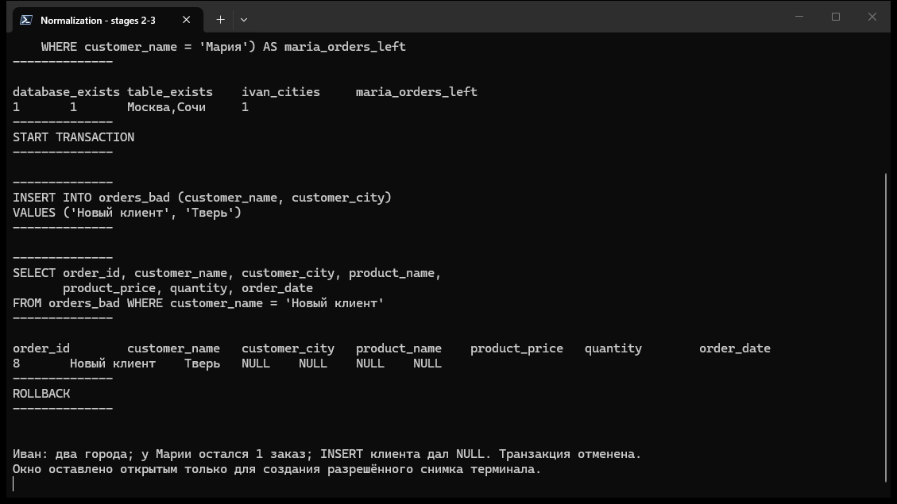
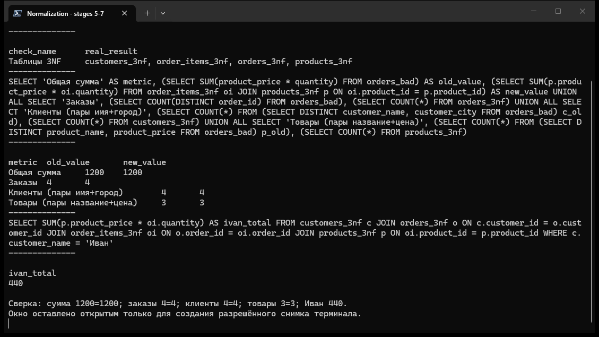
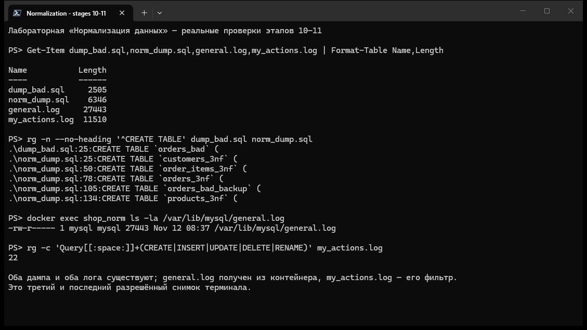

# Лабораторная работа «Нормализация данных»

Оригинальное задание: [«Нормализация данных. Практическое руководство (с ведением лога)»](https://github.com/rurewa/imfua/blob/main/content/Courses/Basics_database_design/content/bd/Normalization.md).

## Цель работы

Продемонстрировать аномалии обновления, удаления и вставки в ненормализованной таблице, привести структуру к третьей нормальной форме (3NF), перенести и проверить данные, получить реальные дампы до и после нормализации и экспортировать общий журнал MySQL.

## Использованные технологии

- Docker Desktop 29.7.2;
- контейнер MySQL 8.0 (сервер 8.0.46);
- MySQL Client и `mysqldump`;
- PowerShell 7;
- `grep` внутри Linux-контейнера для фильтрации журнала;
- кодировка `utf8mb4`, сортировка `utf8mb4_unicode_ci`.

## Артефакты

- [dump_bad.sql](dump_bad.sql) — настоящий дамп до создания таблиц 3NF;
- [norm_dump.sql](norm_dump.sql) — настоящий дамп после этапов 8–9;
- [general.log](general.log) — полный общий журнал, скопированный из контейнера;
- [my_actions.log](my_actions.log) — журнал после применения фильтра преподавателя;
- [CHECKLIST.md](CHECKLIST.md) — детальная сверка задания;
- [sql/](sql/) — SQL-запросы по этапам;
- [evidence/](evidence/) — сохранённый фактический вывод основных команд;
- [screenshots/](screenshots/) — три разрешённых снимка терминала.

## Важные неточности оригинальной инструкции

Исходные команды сохранены и выполнены. Обнаруженные проблемы не исправлялись молча.

1. После этапа 3 у Ивана остаются две пары: `(Иван, Сочи)` и `(Иван, Москва)`. Запрос этапа 6 использует `SELECT DISTINCT customer_name, customer_city`, поэтому создаёт **две** записи Ивана. Схема таблиц соответствует 3NF, но исходный перенос не формирует единственную сущность клиента.
2. На этапе 8 `UPDATE ... WHERE customer_name = 'Иван'` нашёл обе записи. `ROW_COUNT()` вернул `1`, поскольку одна строка уже содержала `Сочи`, а реально изменилось только значение `Москва`. После запроса всё равно остались две строки Ивана с одинаковыми данными.
3. Безопасный вариант этапа 9 переименовывает, а не удаляет `orders_bad`. Поэтому `norm_dump.sql` закономерно содержит пять таблиц: четыре 3NF и `orders_bad_backup`, хотя текст этапа 10 говорит о «четырёх таблицах вместо одной».
4. При bind mount файла с Windows Docker Desktop показывает его в Linux-контейнере как world-writable. MySQL сообщил, что `/etc/mysql/conf.d/my.cnf` игнорируется. Тот же файл был дополнительно скопирован в контейнер как `/etc/mysql/conf.d/normalization.cnf`, получил права `0644`, после чего контейнер был перезапущен. Серверные переменные подтвердили применение всех настроек.
5. Точный фильтр этапа 11 пропускает некоторые служебные `SELECT` от `mysqldump`, так как разрешает любой запрос, начинающийся с `SELECT`, и не исключает обращения к `information_schema`. Файл `my_actions.log` оставлен результатом именно исходного фильтра, без скрытого изменения правила.

Для действительно единственного клиента требуется предварительно согласовать единое значение города и использовать устойчивый идентификатор клиента; имя само по себе не является надёжным уникальным ключом.

## Выполнение этапов 0–11

### Этап 0. Подготовка `my.cnf`

Создан файл [my.cnf](my.cnf) с настройками:

```ini
[mysqld]
character-set-server = utf8mb4
collation-server = utf8mb4_unicode_ci
general_log = 1
general_log_file = /var/lib/mysql/general.log
log_output = FILE
```

После Windows-коррекции сервер реально вернул `character_set_server=utf8mb4`, `collation_server=utf8mb4_unicode_ci`, `general_log=ON`, `general_log_file=/var/lib/mysql/general.log`, `log_output=FILE`.

### Этап 1. Запуск MySQL 8.0

Контейнер создан исходной командой с именем `shop_norm`, паролем из задания, локалью `C.UTF-8`, `MYSQL_INITDB_SKIP_TZINFO=1`, новым томом `mysql_data` и mount файла `my.cnf`:

```powershell
docker run --name shop_norm `
  -e MYSQL_ROOT_PASSWORD=123 `
  -e LANG=C.UTF-8 `
  -e MYSQL_INITDB_SKIP_TZINFO=1 `
  -v mysql_data:/var/lib/mysql `
  -v "${PWD}\my.cnf:/etc/mysql/conf.d/my.cnf" `
  -d mysql:8.0
```

`docker ps` показал контейнер `shop_norm` в состоянии `Up`. После применения конфигурации начальный лог очищен исходной командой:

```sh
docker exec shop_norm sh -c ': > /var/lib/mysql/general.log'
```

Клиент MySQL подключался с `--default-character-set=utf8mb4`.

### Этап 2. База и таблица `orders_bad`

Файл [sql/02_create_bad.sql](sql/02_create_bad.sql) создал `shop_norm`, таблицу `orders_bad` и вставил пять исходных строк без изменения задания. `SHOW DATABASES`, `SHOW TABLES` и `SELECT *` подтвердили результат. Исходная сумма покупок Ивана — **440**.

Фактический вывод: [evidence/02_create_bad.txt](evidence/02_create_bad.txt).

### Этап 3. Демонстрация аномалий

Запросы находятся в [sql/03_anomalies.sql](sql/03_anomalies.sql), очистка — в [sql/03_cleanup.sql](sql/03_cleanup.sql).

| Аномалия | Выполненная операция | Реальный результат | Причина |
| --- | --- | --- | --- |
| Обновления | Изменён город только у `order_id=1` | У Ивана одновременно `Сочи` и `Москва` | Один факт хранится в нескольких строках |
| Удаления | Удалён `order_id=4` | У Марии остался только заказ `order_id=3`; товар `Хурма` исчез из рабочих данных | Клиент и товар зависят от наличия заказа |
| Вставки | Добавлен клиент без полей заказа | `product_name`, `product_price`, `quantity`, `order_date` стали `NULL` | Клиента нельзя хранить отдельно от заказа |

Тестовая строка нового клиента удалена; контрольный запрос вернул `0`. Реальные выводы: [аномалии](evidence/03_anomalies.txt) и [очистка](evidence/03_cleanup.txt).



### Этап 4. Дамп до нормализации

Выполнена настоящая команда:

```powershell
docker exec -e MYSQL_PWD=123 shop_norm mysqldump -uroot shop_norm > dump_bad.sql
```

[dump_bad.sql](dump_bad.sql) имеет размер **2505 байт**, содержит `CREATE TABLE orders_bad` и четыре оставшиеся строки данных после демонстрации аномалий.

### Этап 5. Четыре таблицы 3NF

[sql/05_create_3nf.sql](sql/05_create_3nf.sql) создал:

- `customers_3nf(customer_id, customer_name, customer_city)`;
- `products_3nf(product_id, product_name, product_price)`;
- `orders_3nf(order_id, customer_id, order_date)`;
- `order_items_3nf(order_id, product_id, quantity)`.

Внешние ключи связывают заказы с клиентами, позиции с заказами и товарами. `SHOW TABLES` и четыре команды `DESCRIBE` реально выполнены; вывод сохранён в [evidence/05_create_3nf.txt](evidence/05_create_3nf.txt).

### Этап 6. Перенос данных

Перенос выполнен запросами преподавателя из [sql/06_migrate.sql](sql/06_migrate.sql):

```sql
INSERT INTO customers_3nf (customer_name, customer_city)
SELECT DISTINCT customer_name, customer_city FROM orders_bad;

INSERT INTO products_3nf (product_name, product_price)
SELECT DISTINCT product_name, product_price FROM orders_bad;
```

Затем через `JOIN` перенесены заголовки и позиции заказов. Получено четыре пары клиентов, три пары товаров, четыре заказа и четыре позиции. Две клиентские строки относятся к Ивану из-за ранее созданной аномалии города. Полный вывод: [evidence/06_migrate.txt](evidence/06_migrate.txt).

### Этап 7. Проверка переноса

[sql/07_verify.sql](sql/07_verify.sql) дал следующие результаты:

| Проверка | До переноса | После переноса | Результат |
| --- | ---: | ---: | --- |
| Общая сумма | 1200 | 1200 | Совпало |
| Заказы | 4 | 4 | Совпало |
| Уникальные пары клиент + город | 4 | 4 | Совпало |
| Уникальные пары товар + цена | 3 | 3 | Совпало |
| Покупки Ивана | 440 | 440 | Совпало |

Фактический вывод: [evidence/07_verify.txt](evidence/07_verify.txt).



### Этап 8. Повтор операций после нормализации

[sql/08_no_anomalies.sql](sql/08_no_anomalies.sql) выполнил все три операции:

- город Ивана обновлён запросом к `customers_3nf`; `ROW_COUNT()` равен `1`, но проверка показывает две строки Ивана — ограничение исходного переноса описано выше;
- все позиции и заказы Марии удалены, при этом строка Марии осталась в `customers_3nf`;
- `Новый клиент, Тверь` добавлен непосредственно в `customers_3nf` без фиктивного заказа и без `NULL` в обязательных полях клиента.

Фактический вывод: [evidence/08_no_anomalies.txt](evidence/08_no_anomalies.txt).

### Этап 9. Архивирование старой таблицы

Использован безопасный вариант из задания:

```sql
RENAME TABLE orders_bad TO orders_bad_backup;
SHOW TABLES;
```

Проверка показала четыре таблицы 3NF и `orders_bad_backup`. Вывод: [evidence/09_archive.txt](evidence/09_archive.txt).

### Этап 10. Дамп после нормализации

Выполнена настоящая команда:

```powershell
docker exec -e MYSQL_PWD=123 shop_norm mysqldump -uroot shop_norm > norm_dump.sql
```

[norm_dump.sql](norm_dump.sql) имеет размер **6346 байт**. В нём проверено наличие `customers_3nf`, `products_3nf`, `orders_3nf`, `order_items_3nf` и архивной `orders_bad_backup`.

### Этап 11. Экспорт общего лога

Команда `docker exec shop_norm ls -la /var/lib/mysql/general.log` подтвердила настоящий файл внутри контейнера. Полный вывод был просмотрен и сохранён как [evidence/11_general_log_cat.txt](evidence/11_general_log_cat.txt), затем выполнено:

```powershell
docker cp shop_norm:/var/lib/mysql/general.log ./general.log
```

На Windows те же два `grep` из задания выполнены внутри Linux-контейнера, а результат перенаправлен на хост:

```sh
grep -E "Query[[:space:]]+(CREATE|INSERT|SELECT|UPDATE|DELETE|ALTER|DROP|RENAME|DESCRIBE|EXPLAIN|SHOW DATABASES|SHOW TABLES|SHOW FULL TABLES|SHOW CREATE|SHOW VARIABLES LIKE|SET GLOBAL general_log|SET GLOBAL log_output)" /var/lib/mysql/general.log \
  | grep -v -E "INSERT INTO help_|INSERT INTO time_zone|INSERT INTO mysql\.|SELECT \* FROM mysql\.general_log"
```

Результаты:

- [general.log](general.log) — **27 443 байта**;
- [my_actions.log](my_actions.log) — **11 510 байт**;
- в фильтрованном файле отсутствуют строки типов `Connect`, `Quit`, `SET NAMES`, загрузка `help_`, `time_zone` и чтение `mysql.general_log`;
- присутствуют реальные `CREATE`, `INSERT`, `SELECT`, `UPDATE`, `DELETE`, `DESCRIBE`, `SHOW` и `RENAME` лабораторной.



## Сравнение структуры и данных

| Характеристика | `orders_bad` | Схема 3NF |
| --- | --- | --- |
| Клиент | Повторяется в каждой строке заказа | Отдельная таблица `customers_3nf` |
| Товар и цена | Повторяются в заказах | Отдельная таблица `products_3nf` |
| Заказ | Смешан с клиентом и товаром | Заголовок в `orders_3nf` |
| Позиция | Одна строка одновременно является заказом и позицией | Связь в `order_items_3nf` |
| Клиент без заказа | Требует строки с `NULL` | Добавляется независимо |
| Удаление заказов | Может удалить все сведения о клиенте | Клиент остаётся |
| Проверка переноса | Сумма 1200, 4 заказа | Сумма 1200, 4 заказа до этапа 8 |

Функциональные зависимости разделены по сущностям: `customer_id → customer_name, customer_city`, `product_id → product_name, product_price`, `order_id → customer_id, order_date`, `(order_id, product_id) → quantity`. Неключевые атрибуты не зависят друг от друга транзитивно внутри соответствующих таблиц.

## Сверка этапов и подтверждения

| Этап | Что требовалось | Что реально выполнено | Подтверждение |
| ---: | --- | --- | --- |
| 0 | `my.cnf`, UTF-8, общий лог | Создан, применён с Windows-коррекцией, переменные проверены | [my.cnf](my.cnf) |
| 1 | Запустить и проверить MySQL 8.0, очистить лог, подключиться | `shop_norm` запущен, лог очищен, клиент подключён | [general.log](general.log) |
| 2 | Создать БД, `orders_bad`, данные и проверки | Все исходные запросы выполнены, Иван — 440 | [SQL](sql/02_create_bad.sql), [вывод](evidence/02_create_bad.txt) |
| 3 | Показать три аномалии и очистить тестовую строку | Все аномалии показаны, тестовая строка удалена | [вывод](evidence/03_anomalies.txt) |
| 4 | Дамп до 3NF | Настоящий дамп, 2505 байт | [dump_bad.sql](dump_bad.sql) |
| 5 | Создать и описать четыре таблицы | Выполнены четыре `CREATE`, `SHOW`, четыре `DESCRIBE` | [вывод](evidence/05_create_3nf.txt) |
| 6 | Перенести данные исходными запросами | Клиенты, товары, заказы и позиции перенесены | [вывод](evidence/06_migrate.txt) |
| 7 | Сверить суммы, количества и Ивана | Все пары контрольных значений совпали | [вывод](evidence/07_verify.txt) |
| 8 | Повторить update/delete/insert | Выполнено, реальные ограничения исходных данных зафиксированы | [вывод](evidence/08_no_anomalies.txt) |
| 9 | Обработать старую таблицу | Безопасно переименована в архив | [вывод](evidence/09_archive.txt) |
| 10 | Дамп после нормализации | Настоящий дамп, 6346 байт, пять ожидаемых таблиц | [norm_dump.sql](norm_dump.sql) |
| 11 | Проверить, экспортировать и отфильтровать лог | Получены полный и фильтрованный реальные файлы | [general.log](general.log), [my_actions.log](my_actions.log) |

## Вывод

Лабораторная выполнена последовательно от этапа 0 до этапа 11 на реальном MySQL 8.0. Проверка сумм и количеств доказала корректность переноса на момент этапа 7. Разделение сущностей устранило зависимость существования клиента от заказа и позволило добавлять клиента без фиктивной продажи. Одновременно практическое выполнение выявило, что нормальная форма структуры не исправляет противоречивые исходные данные автоматически: для Ивана необходима отдельная очистка и надёжный идентификатор клиента.
