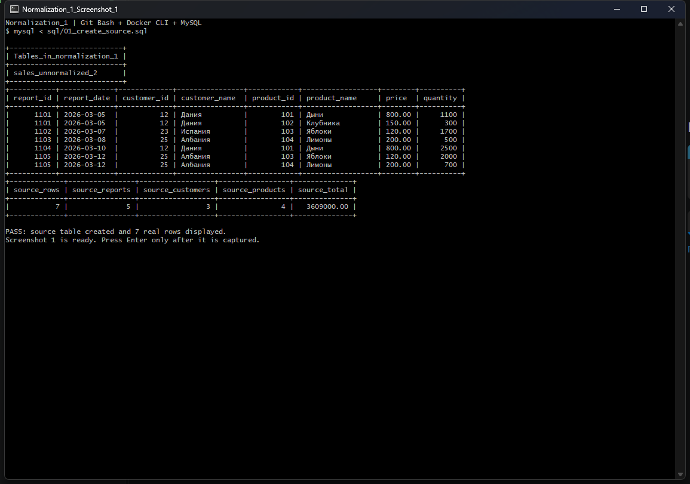
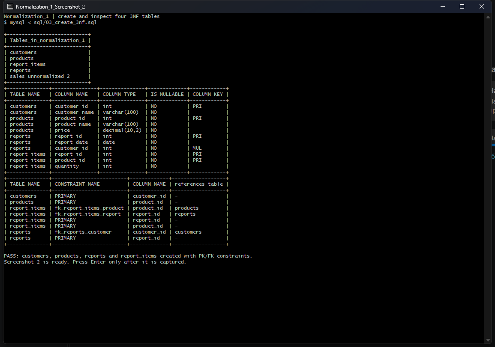
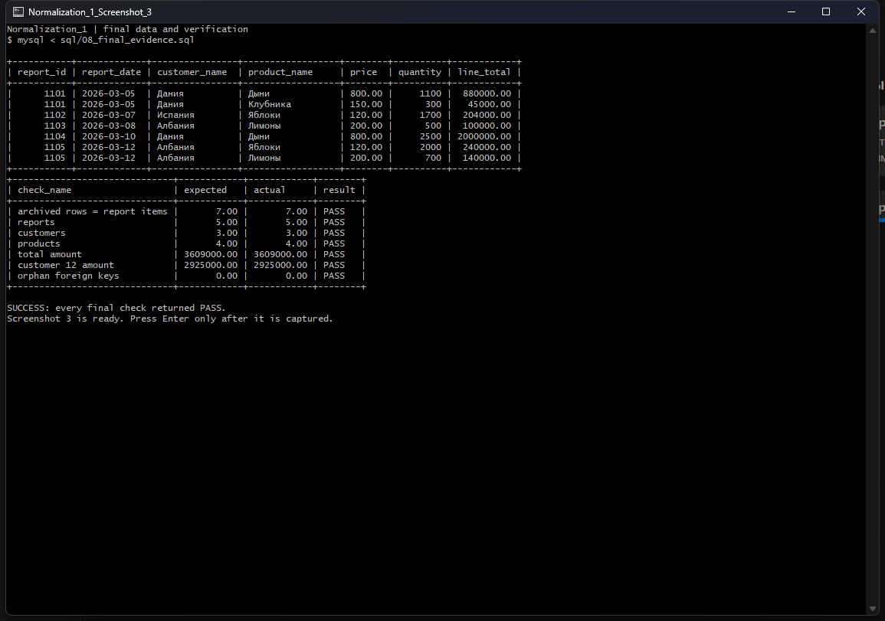

# Лабораторная работа `Normalization_1`

Работа выполнена по [оригинальной инструкции преподавателя](https://github.com/rurewa/imfua/blob/main/content/Courses/Basics_database_design/content/bd/Normalization_1.md): исходная таблица `sales_unnormalized_2` приведена к 3NF, данные перенесены через `INSERT ... SELECT`, а результаты подтверждены настоящими выводами MySQL, двумя дампами, журналом действий и тремя скриншотами.

> Это отдельная работа. Существующая лабораторная [`../Normalization`](../Normalization/) не изменялась.

## Итог

| Проверка | Результат |
|---|---:|
| Строк в исходной/архивной таблице | 7 |
| Покупателей | 3 |
| Товаров | 4 |
| Отчётов | 5 |
| Позиций отчётов | 7 |
| Сумма до нормализации | 3 609 000.00 |
| Сумма после нормализации | 3 609 000.00 |
| Разница сумм | 0.00 |
| Потратил покупатель 12 | 2 925 000.00 |
| Потерянные строки | 0 |
| Нарушенные внешние ключи | 0 |
| Результат итоговых проверок | **PASS** |

Полная сверка требований находится в [`CHECKLIST.md`](CHECKLIST.md).

## Проверка, что работа новая

До выполнения были проверены файлы и история Git:

```bash
rg -n -i "sales_unnormalized_2|normalization_1|Дания|Испания|Албания" .
git log --all --oneline -- MySQL/Normalization_1
git log --all --oneline -S "sales_unnormalized_2" -- .
```

Совпадений с этой лабораторной не найдено. В репозитории была только другая работа `MySQL/Normalization`, основанная на `Normalization.md` и использующая `orders_bad`.

## Расхождение в инструкции

Во вводном списке `Normalization_1.md` упомянуты БД `sales_norm` и таблица `orders_bad`, но подробное практическое задание, исходные данные и весь порядок выполнения требуют новую БД и таблицу `sales_unnormalized_2`. Чтобы не затронуть прежнюю лабораторную, создана уникальная БД `normalization_1`; имя таблицы и семь строк взяты из подробной части инструкции без изменений.

## Среда и изоляция

Работа выполнена 13 ноября 2026 года в VS Code, Git Bash, Docker CLI и MySQL:

| Инструмент | Версия |
|---|---|
| VS Code | 1.146.0 |
| Git for Windows / Git Bash | 2.56.1.windows.1 |
| Docker CLI / Engine | 29.7.2 / 29.7.2 |
| MySQL | 8.4.11 (`mysql:8.4`) |

Контейнер `normalization-1-mysql` создан отдельно, без публикации портов на хост и без пароля, поэтому существующие контейнеры и базы других работ не менялись:

```bash
docker run --name normalization-1-mysql \
  --label lab=Normalization_1 \
  -e MYSQL_ALLOW_EMPTY_PASSWORD=yes \
  -d mysql:8.4 \
  --character-set-server=utf8mb4 \
  --collation-server=utf8mb4_0900_ai_ci
```

## 1. Исходная таблица

Сценарий [`sql/01_create_source.sql`](sql/01_create_source.sql) создаёт БД `normalization_1`, таблицу из восьми столбцов и вставляет все семь строк преподавателя:

```bash
docker exec -i normalization-1-mysql \
  mysql -uroot --default-character-set=utf8mb4 --table \
  < sql/01_create_source.sql
```

Реальный текстовый вывод сохранён в [`evidence/01_source_creation.txt`](evidence/01_source_creation.txt).



## 2. Почему исходная схема не нормализована

- В исходном визуальном представлении один отчёт содержит повторяющуюся группу товаров. После переноса в плоскую реляционную таблицу значения стали атомарными, но дата и покупатель повторяются в каждой позиции.
- Естественный ключ строки — `(report_id, product_id)`. `report_date` и `customer_id` зависят только от `report_id`, а `product_name` и `price` — только от `product_id`; это частичные зависимости и нарушение 2NF.
- `customer_id → customer_name` и `product_id → product_name, price` создают транзитивные зависимости относительно строки продажи; это нарушение 3NF.
- В исходном DDL преподавателя первичный ключ физически не объявлен, поэтому база также не защищает от дублирования строк.

## 3. Реальные аномалии

Сценарий [`sql/02_demonstrate_anomalies.sql`](sql/02_demonstrate_anomalies.sql) выполняет каждую демонстрацию в транзакции и затем делает `ROLLBACK`, чтобы исходные данные не исказились. Полный вывод: [`evidence/02_anomalies.txt`](evidence/02_anomalies.txt).

| Аномалия | Что было реально показано |
|---|---|
| Обновления | Одна строка покупателя 12 стала «Дания (изменена одна строка)», а две другие остались «Дания». |
| Вставки | Для покупателя 30 без отчёта пришлось создать фиктивную строку продажи с `NULL` во всех полях отчёта и товара. |
| Удаления | После удаления единственной строки покупателя 23 число строк с данными Испании стало 0. |

После каждого отката MySQL вернул `PASS: rollback restored the source`. Затем создан настоящий дамп до нормализации: [`dump_before_normalization.sql`](dump_before_normalization.sql).

## 4. Схема в 3NF

Сценарий [`sql/03_create_3nf.sql`](sql/03_create_3nf.sql) создал четыре требуемые таблицы:

```text
customers (1) ──< reports (1) ──< report_items >── (1) products
```

| Таблица | Первичный ключ | Внешние ключи |
|---|---|---|
| `customers` | `customer_id` | — |
| `products` | `product_id` | — |
| `reports` | `report_id` | `customer_id → customers.customer_id` |
| `report_items` | `(report_id, product_id)` | `report_id → reports.report_id`; `product_id → products.product_id` |

Для цены и количества дополнительно заданы проверки неотрицательной цены и положительного количества. Все внешние ключи используют `ON DELETE RESTRICT`, чтобы связанные справочные данные нельзя было случайно потерять.

Структура и ограничения сохранены в [`evidence/03_create_3nf.txt`](evidence/03_create_3nf.txt).



## 5. Перенос через `INSERT ... SELECT`

В [`sql/04_migrate.sql`](sql/04_migrate.sql) выполнены четыре операции из задания:

```sql
INSERT INTO customers (customer_id, customer_name)
SELECT DISTINCT customer_id, customer_name FROM sales_unnormalized_2;

INSERT INTO products (product_id, product_name, price)
SELECT DISTINCT product_id, product_name, price FROM sales_unnormalized_2;

INSERT INTO reports (report_id, report_date, customer_id)
SELECT DISTINCT report_id, report_date, customer_id FROM sales_unnormalized_2;

INSERT INTO report_items (report_id, product_id, quantity)
SELECT report_id, product_id, quantity FROM sales_unnormalized_2;
```

Фактически вставлено 3 покупателя, 4 товара, 5 отчётов и 7 позиций. Реальный вывод: [`evidence/04_migrate.txt`](evidence/04_migrate.txt).

## 6. Проверка данных и связей

Все запросы находятся в [`sql/05_verify.sql`](sql/05_verify.sql), полный вывод — в [`evidence/05_verify.txt`](evidence/05_verify.txt).

- Число исходных строк совпало с числом позиций: `7 = 7`.
- Число уникальных отчётов совпало: `5 = 5`.
- Число уникальных покупателей совпало: `3 = 3`.
- Число уникальных товаров совпало: `4 = 4`.
- `SUM(price * quantity)` до и после: `3 609 000.00 = 3 609 000.00`.
- Разница сумм: `0.00`.
- Строк, которые нельзя восстановить соединением четырёх таблиц: `0`.
- «Сиротских» отчётов, позиций и товаров: `0`; `foreign_key_checks = 1`.
- Тестовый запрос из задания вернул для покупателя 12 сумму `2 925 000.00`.

Суммы по всем покупателям:

| Код | Покупатель | Сумма |
|---:|---|---:|
| 12 | Дания | 2 925 000.00 |
| 23 | Испания | 204 000.00 |
| 25 | Албания | 480 000.00 |

## 7. Аномалии после нормализации

[`sql/06_anomalies_resolved.sql`](sql/06_anomalies_resolved.sql) подтвердил результат; вывод сохранён в [`evidence/06_anomalies_resolved.txt`](evidence/06_anomalies_resolved.txt).

- Название покупателя хранится один раз: одно обновление `customers` стало видно во всех трёх связанных позициях покупателя 12.
- Покупатель 30 добавился в `customers` с нулём отчётов, без фиктивной продажи.
- Попытка удалить покупателя 23 была заблокирована внешним ключом; покупатель остался в справочнике.

Все тестовые изменения выполнены транзакционно и отменены.

## 8. Архивирование, дампы и журнал

Только после всех успешных проверок [`sql/07_archive_source.sql`](sql/07_archive_source.sql) переименовал исходную таблицу в `sales_unnormalized_2_archived`. В ней осталось 7 строк: [`evidence/07_archive_source.txt`](evidence/07_archive_source.txt).

- [`dump_before_normalization.sql`](dump_before_normalization.sql) — исходная БД с одной ненормализованной таблицей.
- [`dump_after_normalization.sql`](dump_after_normalization.sql) — четыре таблицы 3NF с PK/FK и архивная исходная таблица.
- [`evidence/09_dump_restore_check.txt`](evidence/09_dump_restore_check.txt) — реальное восстановление обоих дампов в отдельном временном контейнере: до `7 / 3 609 000.00`, после `3 / 4 / 5 / 7 / 7 / 3 609 000.00`, итог `PASS`.

Перед началом в отдельном контейнере был очищен и включён MySQL General Query Log с `log_output=TABLE`. После последней проверки журнал отключён и экспортирован сценарием [`scripts/export_log.sh`](scripts/export_log.sh). Файл [`my_actions.log`](my_actions.log) содержит только SQL-запросы этой работы; подключения и системные сообщения исключены. Время журнала записано MySQL в UTC.

## 9. Финальный результат

Итоговый запрос [`sql/08_final_evidence.sql`](sql/08_final_evidence.sql) восстановил все строки соединением четырёх таблиц и вернул `PASS` для количества строк, справочников, суммы, суммы покупателя 12 и целостности FK. Текстовый вывод: [`evidence/08_final_evidence.txt`](evidence/08_final_evidence.txt).



## Файлы и повторный запуск

- [`sql/`](sql/) — последовательные SQL-сценарии `00`–`08`.
- [`evidence/`](evidence/) — реальные текстовые результаты каждого этапа.
- [`screenshots/`](screenshots/) — ровно три разрешённых снимка терминала.
- [`scripts/run_before_3nf.sh`](scripts/run_before_3nf.sh) и [`scripts/run_after_3nf.sh`](scripts/run_after_3nf.sh) — этапы выполнения через Git Bash и Docker CLI.
- [`scripts/verify_dumps.sh`](scripts/verify_dumps.sh) — изолированная проверка восстановления дампов.
- [`scripts/run_all.sh`](scripts/run_all.sh) — полный повторный запуск лабораторной в контейнере `normalization-1-mysql`.

Полный запуск из Git Bash в этой папке:

```bash
bash ./scripts/run_all.sh
```

Сценарий создаёт или запускает только контейнер `normalization-1-mysql`, пересоздаёт только БД `normalization_1` внутри него и не обращается к контейнерам или базам других лабораторных.
