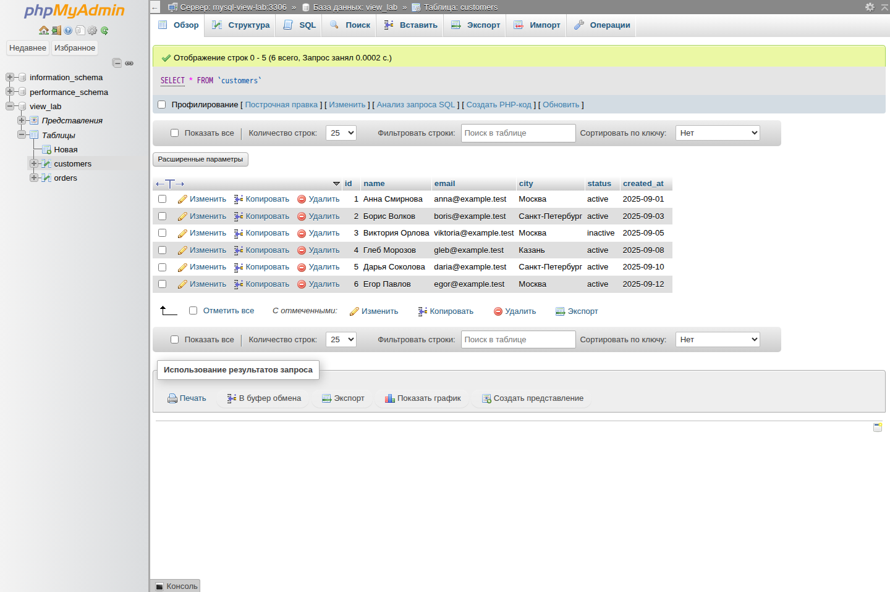
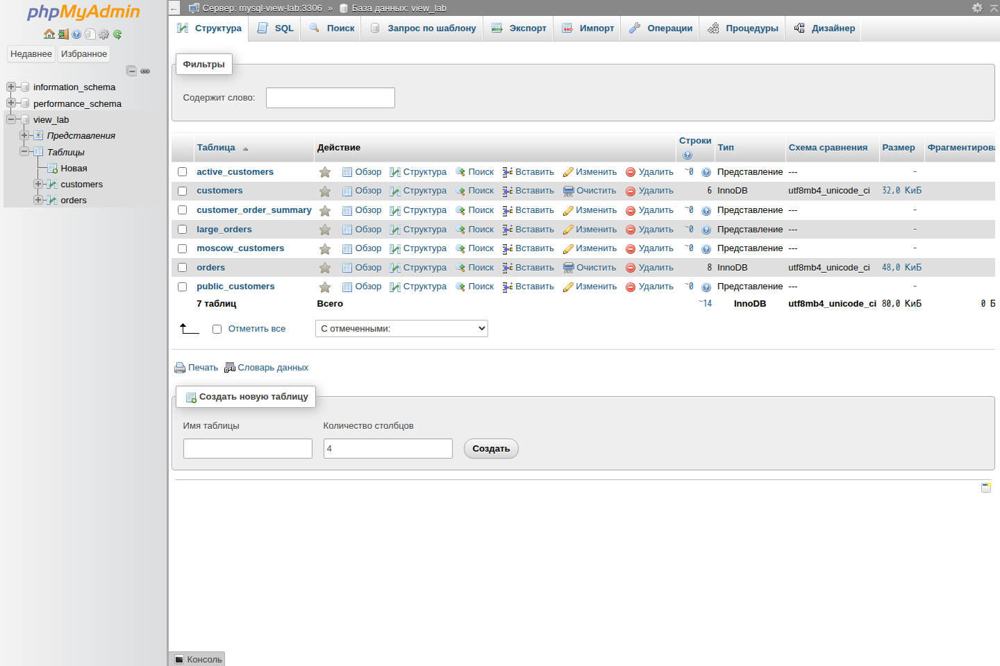
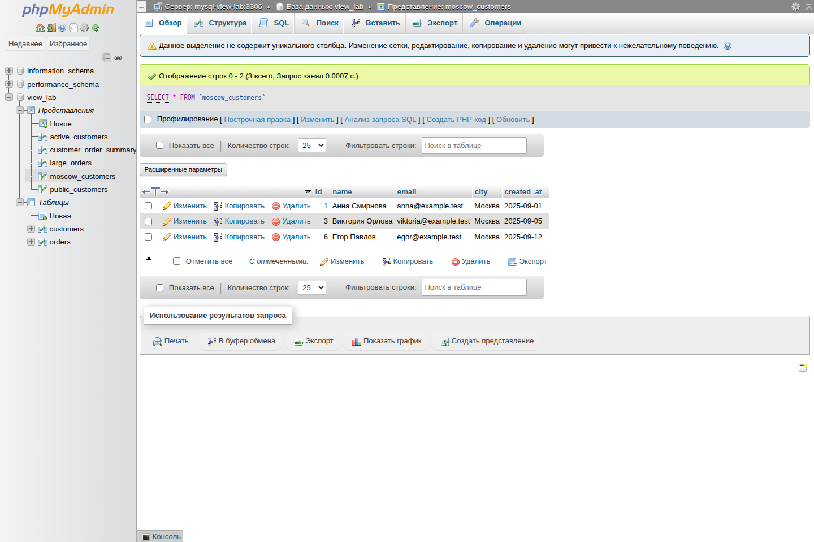
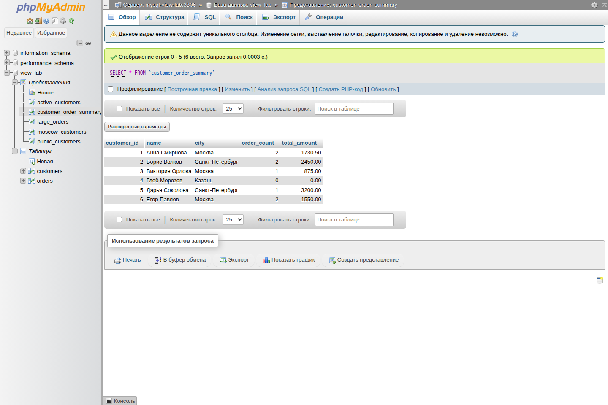
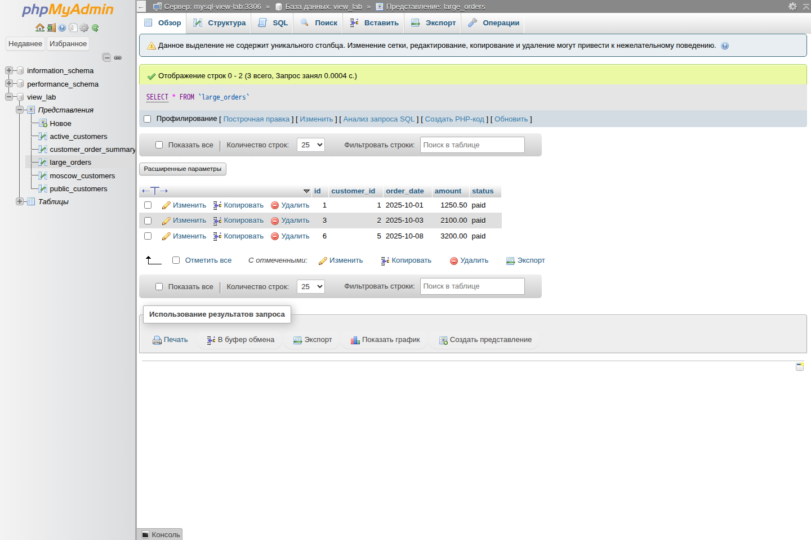
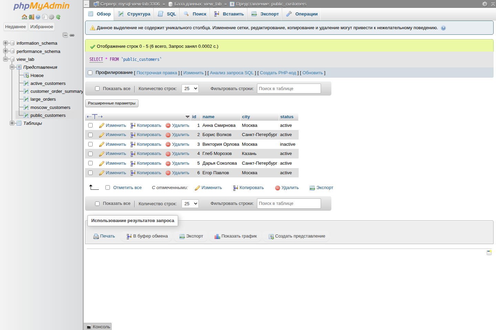
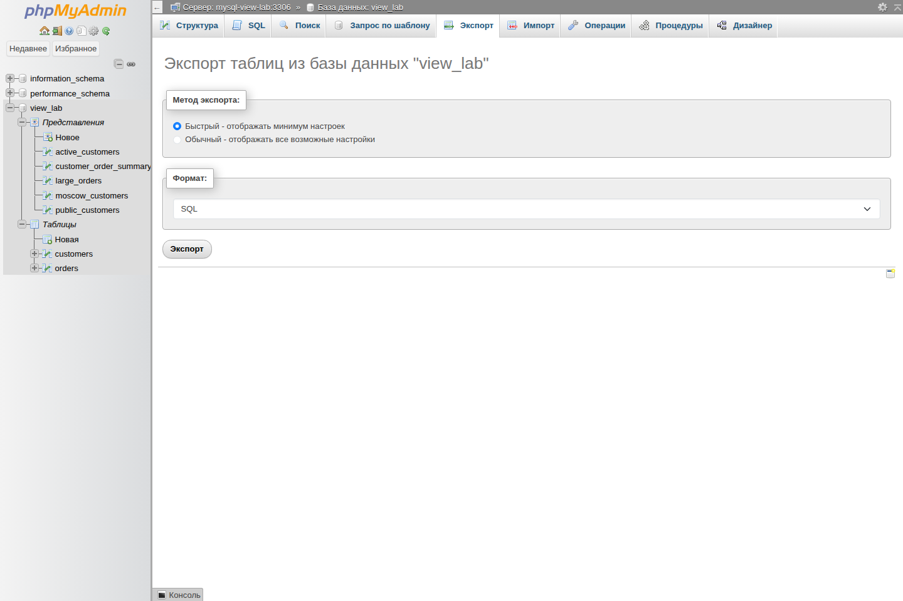

# Представления (VIEW) в MySQL

## Цель работы

Изучить представления MySQL на самостоятельной учебной базе: создать простые и составные `VIEW`, проверить фильтрацию, агрегирование, обновляемость, `WITH CHECK OPTION`, права доступа, просмотр определения и удаление представлений. В завершение — получить настоящий `mysqldump` и восстановить базу из него.

Работа выполнена на **MySQL 8.0.46**. Все приведённые результаты получены реальными запросами к базе `view_lab` 3 ноября 2026 года. Изменяющие демонстрационные запросы выполнялись в транзакциях с `ROLLBACK`, поэтому итоговый дамп содержит чистый исходный набор данных.

## Подготовка учебной базы

Используются две связанные таблицы:

- `customers` — клиенты;
- `orders` — заказы клиентов.

Связь: `orders.customer_id → customers.id`. В базе находятся 6 клиентов и 8 заказов. Полный воспроизводимый сценарий доступен в файле [`setup.sql`](setup.sql), а готовая резервная копия — в [`dump.sql`](dump.sql).

```sql
CREATE DATABASE view_lab
  CHARACTER SET utf8mb4
  COLLATE utf8mb4_unicode_ci;

USE view_lab;

CREATE TABLE customers (
    id         INT UNSIGNED AUTO_INCREMENT PRIMARY KEY,
    name       VARCHAR(100) NOT NULL,
    email      VARCHAR(120) NOT NULL UNIQUE,
    city       VARCHAR(60) NOT NULL,
    status     ENUM('active', 'inactive') NOT NULL DEFAULT 'active',
    created_at DATE NOT NULL
) ENGINE = InnoDB;

CREATE TABLE orders (
    id          INT UNSIGNED AUTO_INCREMENT PRIMARY KEY,
    customer_id INT UNSIGNED NOT NULL,
    order_date  DATE NOT NULL,
    amount      DECIMAL(10, 2) NOT NULL,
    status      ENUM('new', 'paid', 'shipped', 'cancelled') NOT NULL,
    CONSTRAINT fk_orders_customer
        FOREIGN KEY (customer_id) REFERENCES customers (id),
    INDEX idx_orders_customer_id (customer_id),
    INDEX idx_orders_status (status)
) ENGINE = InnoDB;
```

Проверка исходных данных:

```sql
SELECT id, name, city, status FROM customers ORDER BY id;
SELECT COUNT(*) FROM orders;
```

| id | name | city | status |
|---:|---|---|---|
| 1 | Анна Смирнова | Москва | active |
| 2 | Борис Волков | Санкт-Петербург | active |
| 3 | Виктория Орлова | Москва | inactive |
| 4 | Глеб Морозов | Казань | active |
| 5 | Дарья Соколова | Санкт-Петербург | active |
| 6 | Егор Павлов | Москва | active |

Количество строк в `orders`: **8**.



*Исходные строки таблицы `customers` в phpMyAdmin. На снимке нет паролей или других секретов.*

---

## 1. Что такое VIEW

`VIEW` (представление) — именованный запрос `SELECT`, к которому можно обращаться как к таблице. Обычное представление MySQL хранит определение запроса, а не отдельную копию его результата.

```sql
SELECT * FROM имя_представления;
```

При обращении к `VIEW` сервер получает актуальные данные из базовых таблиц. Если строка в `customers` изменилась, подходящее представление покажет изменение без отдельного обновления.

Важно отличать обычный `VIEW` от материализованного представления: встроенных materialized views в MySQL 8.0 нет. Поэтому само создание `VIEW` не превращает сложный запрос в заранее рассчитанную таблицу.

---

## 2. Зачем нужен VIEW

| Задача | Что даёт представление |
|---|---|
| Сокращение запросов | Сложный `JOIN` и `GROUP BY` сохраняются под понятным именем |
| Повторное использование | Одно определение применяется во многих запросах |
| Стабильный интерфейс | Клиентский код обращается к фиксированному набору столбцов |
| Ограничение данных | Внутренний `WHERE` показывает только разрешённые строки |
| Сокрытие столбцов | Например, можно не включать `email` в публичный `VIEW` |
| Разграничение доступа | Пользователю выдаётся право на `VIEW`, но не на исходную таблицу |

Структура готовой базы: две обычные таблицы и пять представлений.



*phpMyAdmin отдельно помечает `active_customers`, `customer_order_summary`, `large_orders`, `moscow_customers` и `public_customers` как представления.*

---

## 3. Простейшее представление

Задача: часто получать список клиентов из Москвы.

Без представления запрос пришлось бы повторять:

```sql
SELECT id, name, email, city, created_at
FROM customers
WHERE city = 'Москва';
```

Создадим `moscow_customers`:

```sql
CREATE VIEW moscow_customers AS
SELECT id, name, email, city, created_at
FROM customers
WHERE city = 'Москва';
```

Теперь запрос короче:

```sql
SELECT * FROM moscow_customers ORDER BY id;
```

Реальный результат:

| id | name | email | city | created_at |
|---:|---|---|---|---|
| 1 | Анна Смирнова | anna@example.test | Москва | 2025-09-01 |
| 3 | Виктория Орлова | viktoria@example.test | Москва | 2025-09-05 |
| 6 | Егор Павлов | egor@example.test | Москва | 2025-09-12 |



*phpMyAdmin выполняет `SELECT * FROM moscow_customers` и получает три актуальные строки.*

`VIEW` не скопировал этих клиентов: условие `city = 'Москва'` применяется к `customers` при чтении.

---

## 4. VIEW с JOIN и агрегацией

Задача: по каждому клиенту вывести число заказов и общую сумму. `LEFT JOIN` сохраняет в результате даже клиента без заказов, а `COALESCE` заменяет `NULL` на `0.00`.

```sql
CREATE VIEW customer_order_summary AS
SELECT
    c.id AS customer_id,
    c.name,
    c.city,
    COUNT(o.id) AS order_count,
    COALESCE(SUM(o.amount), 0.00) AS total_amount
FROM customers AS c
LEFT JOIN orders AS o ON o.customer_id = c.id
GROUP BY c.id, c.name, c.city;
```

```sql
SELECT *
FROM customer_order_summary
ORDER BY total_amount DESC;
```

| customer_id | name | city | order_count | total_amount |
|---:|---|---|---:|---:|
| 5 | Дарья Соколова | Санкт-Петербург | 1 | 3200.00 |
| 2 | Борис Волков | Санкт-Петербург | 2 | 2450.00 |
| 1 | Анна Смирнова | Москва | 2 | 1730.50 |
| 6 | Егор Павлов | Москва | 2 | 1550.00 |
| 3 | Виктория Орлова | Москва | 1 | 875.00 |
| 4 | Глеб Морозов | Казань | 0 | 0.00 |



*Вместо повторения `LEFT JOIN`, `COUNT`, `SUM` и `GROUP BY` достаточно выбрать данные из `customer_order_summary`.*

К представлению можно добавлять внешнее условие:

```sql
SELECT name, total_amount
FROM customer_order_summary
WHERE total_amount > 2000
ORDER BY total_amount DESC;
```

| name | total_amount |
|---|---:|
| Дарья Соколова | 3200.00 |
| Борис Волков | 2450.00 |

---

## 5. VIEW с фильтрацией внутри

Представление может сразу оставлять только нужные строки. Например, крупные заказы от 1000 рублей:

```sql
CREATE VIEW large_orders AS
SELECT id, customer_id, order_date, amount, status
FROM orders
WHERE amount >= 1000.00;
```

```sql
SELECT * FROM large_orders ORDER BY amount DESC;
```

| id | customer_id | order_date | amount | status |
|---:|---:|---|---:|---|
| 6 | 5 | 2025-10-08 | 3200.00 | paid |
| 3 | 2 | 2025-10-03 | 2100.00 | paid |
| 1 | 1 | 2025-10-01 | 1250.50 | paid |



*Условие находится внутри `large_orders`, поэтому небольшие заказы в результат не попадают.*

Дополнительная фильтрация снаружи тоже допустима:

```sql
SELECT *
FROM large_orders
WHERE status = 'paid';
```

---

## 6. Просмотр существующих VIEW

Список представлений в выбранной базе:

```sql
SHOW FULL TABLES WHERE Table_type = 'VIEW';
```

| Tables_in_view_lab | Table_type |
|---|---|
| active_customers | VIEW |
| customer_order_summary | VIEW |
| large_orders | VIEW |
| moscow_customers | VIEW |
| public_customers | VIEW |

Метаданные удобно смотреть через `information_schema.VIEWS`:

```sql
SELECT TABLE_NAME, IS_UPDATABLE, CHECK_OPTION, SECURITY_TYPE
FROM information_schema.VIEWS
WHERE TABLE_SCHEMA = 'view_lab'
ORDER BY TABLE_NAME;
```

| TABLE_NAME | IS_UPDATABLE | CHECK_OPTION | SECURITY_TYPE |
|---|---|---|---|
| active_customers | YES | NONE | DEFINER |
| customer_order_summary | NO | NONE | DEFINER |
| large_orders | YES | NONE | DEFINER |
| moscow_customers | YES | CASCADED | DEFINER |
| public_customers | YES | NONE | DEFINER |

Полное определение одного объекта:

```sql
SHOW CREATE VIEW moscow_customers\G
```

MySQL вернул определение с `ALGORITHM=MERGE`, `SQL SECURITY DEFINER` и условием проверки:

```sql
CREATE ALGORITHM=MERGE
DEFINER=`root`@`localhost`
SQL SECURITY DEFINER
VIEW `moscow_customers` AS
SELECT id, name, email, city, created_at
FROM customers
WHERE city = 'Москва'
WITH CASCADED CHECK OPTION;
```

`DEFINER` фиксирует владельца, а `SQL SECURITY DEFINER` означает, что при чтении проверяются права владельца представления. Для переносимого дампа его следует импортировать пользователем, который может создать такой `VIEW` (в данной работе — `root`).

---

## 7. Изменение и удаление VIEW

Для замены определения без отдельного удаления используется `CREATE OR REPLACE VIEW`.

Первый вариант содержал три столбца:

```sql
CREATE OR REPLACE VIEW moscow_customers AS
SELECT id, name, email
FROM customers
WHERE city = 'Москва';
```

После замены добавлены `city`, `created_at` и проверка строк:

```sql
CREATE OR REPLACE VIEW moscow_customers AS
SELECT id, name, email, city, created_at
FROM customers
WHERE city = 'Москва'
WITH CASCADED CHECK OPTION;
```

Фактическая проверка `SHOW COLUMNS FROM moscow_customers` показала пять столбцов: `id`, `name`, `email`, `city`, `created_at`.

Для проверки удаления было создано временное представление:

```sql
CREATE VIEW draft_customer_names AS
SELECT id, name FROM customers;

DROP VIEW draft_customer_names;
```

Проверка после удаления:

```sql
SELECT COUNT(*) AS view_exists_after_drop
FROM information_schema.VIEWS
WHERE TABLE_SCHEMA = 'view_lab'
  AND TABLE_NAME = 'draft_customer_names';
```

| view_exists_after_drop |
|---:|
| 0 |

Для повторяемых сценариев безопаснее писать:

```sql
DROP VIEW IF EXISTS draft_customer_names;
```

---

## 8. Обновляемые VIEW (`UPDATE`, `INSERT`, `DELETE`)

### 8.1. Обновляемое представление

Если строку `VIEW` можно однозначно сопоставить строке одной базовой таблицы, MySQL обычно разрешает изменение.

```sql
CREATE VIEW active_customers AS
SELECT id, name, email, city, created_at
FROM customers
WHERE status = 'active';
```

Проверка `UPDATE` выполнена внутри транзакции:

```sql
START TRANSACTION;

UPDATE active_customers
SET city = 'Тула'
WHERE id = 2;

SELECT id, name, city FROM customers WHERE id = 2;
ROLLBACK;
```

До изменения город был `Санкт-Петербург`; после `UPDATE` базовая таблица действительно вернула:

| id | name | city |
|---:|---|---|
| 2 | Борис Волков | Тула |

После `ROLLBACK` снова получен `Санкт-Петербург`.

Проверка `INSERT` и `DELETE`:

```sql
START TRANSACTION;

INSERT INTO active_customers (name, email, city, created_at)
VALUES ('Жанна Белова', 'zhanna@example.test', 'Омск', '2025-11-01');

SET @new_id = LAST_INSERT_ID();
SELECT id, name, city FROM customers WHERE id = @new_id;

DELETE FROM active_customers WHERE id = @new_id;
SELECT COUNT(*) FROM customers WHERE id = @new_id;

ROLLBACK;
```

Вставленная строка получила `id = 7`, появилась в `customers`, а после `DELETE` контрольный `COUNT(*)` вернул `0`.

### 8.2. Необновляемое представление

`customer_order_summary` содержит `JOIN`, `GROUP BY`, `COUNT` и `SUM`. Результирующую строку нельзя однозначно преобразовать обратно в одну строку таблицы.

```sql
UPDATE customer_order_summary
SET name = 'Тест'
WHERE customer_id = 1;
```

Настоящий ответ MySQL:

```text
ERROR 1288 (HY000): The target table customer_order_summary
of the UPDATE is not updatable
```

Частые признаки необновляемого `VIEW`: `GROUP BY`, агрегатные функции, `DISTINCT`, `UNION`, оконные функции и некоторые виды `JOIN`.

---

## 9. VIEW и производительность

Обычный `VIEW` не имеет собственного хранилища и собственных индексов. Индексы создаются на базовых таблицах (`customers`, `orders`), а оптимизатор MySQL пытается объединить внешний запрос с определением представления.

Для простых представлений возможен алгоритм `MERGE`. Агрегированному `customer_order_summary` MySQL может потребоваться промежуточный результат.

Проверим план:

```sql
EXPLAIN
SELECT *
FROM customer_order_summary
WHERE city = 'Москва';
```

Сокращённый фактический план:

| select_type | table | type | key | rows | Extra |
|---|---|---|---|---:|---|
| PRIMARY | `<derived2>` | ALL | NULL | 2 | NULL |
| DERIVED | c | ALL | NULL | 7 | Using where; Using temporary |
| DERIVED | o | ref | idx_orders_customer_id | 1 | NULL |

Из плана видно:

- агрегированное представление обрабатывается как производный результат (`DERIVED`);
- для `orders` использован индекс `idx_orders_customer_id`;
- для группировки понадобилась временная структура (`Using temporary`).

Вывод: `VIEW` улучшает читаемость и повторное использование, но не гарантирует ускорение. Для тяжёлых запросов нужно проверять `EXPLAIN`, индексировать базовые таблицы и при необходимости хранить заранее рассчитанный результат отдельно.

---

## 10. `WITH CHECK OPTION`

Без проверки через фильтрованный обновляемый `VIEW` иногда можно записать строку, которая сразу станет через него невидимой. Это предотвращает `WITH CHECK OPTION`.

```sql
CREATE OR REPLACE VIEW moscow_customers AS
SELECT id, name, email, city, created_at
FROM customers
WHERE city = 'Москва'
WITH CASCADED CHECK OPTION;
```

Попытка вставить клиента из Казани:

```sql
INSERT INTO moscow_customers (name, email, city, created_at)
VALUES ('Пётр Кузнецов', 'petr@example.test', 'Казань', '2025-11-02');
```

Реальная ошибка:

```text
ERROR 1369 (HY000): CHECK OPTION failed 'view_lab.moscow_customers'
```

Строка из Москвы успешно проходит проверку:

```sql
START TRANSACTION;

INSERT INTO moscow_customers (name, email, city, created_at)
VALUES ('Ирина Лебедева', 'irina@example.test', 'Москва', '2025-11-03');

SELECT id, name, city
FROM moscow_customers
WHERE email = 'irina@example.test';

ROLLBACK;
```

| id | name | city |
|---:|---|---|
| 8 | Ирина Лебедева | Москва |

После отката контрольный запрос к `customers` вернул `0` строк с этим адресом.

`CASCADED` применяет ограничения текущего и всех нижележащих представлений. В данной работе вложенных `VIEW` нет, но режим указан явно.

---

## 11. Права доступа через VIEW

Представление `public_customers` намеренно не раскрывает `email` и дату регистрации:

```sql
CREATE VIEW public_customers AS
SELECT id, name, city, status
FROM customers;
```



*В `public_customers` доступны только четыре разрешённых столбца.*

Пример настройки прав (вместо плейсхолдера нужно задать собственный сильный пароль):

```sql
CREATE USER 'view_analyst'@'localhost'
IDENTIFIED BY '<STRONG_LOCAL_PASSWORD>';

GRANT SELECT
ON view_lab.public_customers
TO 'view_analyst'@'localhost';
```

Проверка проведена отдельным локальным пользователем:

```sql
SELECT * FROM public_customers ORDER BY id LIMIT 3;
```

Запрос успешно вернул три строки без `email`. Прямое чтение базовой таблицы:

```sql
SELECT email FROM customers LIMIT 1;
```

было отклонено:

```text
ERROR 1142 (42000): SELECT command denied to user
'view_analyst'@'localhost' for table 'customers'
```

Следовательно, `VIEW` может выступать ограниченным интерфейсом к данным, если права на исходные таблицы не выданы.

---

## 12. Создание дампа

Дамп создан штатной утилитой `mysqldump` из того же контейнера MySQL:

```bash
mysqldump -u root -p \
  --default-character-set=utf8mb4 \
  --set-gtid-purged=OFF \
  --no-tablespaces \
  --routines --triggers --events \
  --databases view_lab \
  --result-file=/tmp/view_lab_dump.sql
```

После создания файл был скопирован в `MySQL/VIEW/dump.sql`.

Параметры полученного файла:

| Проверка | Результат |
|---|---|
| Размер | 11 849 байт |
| Версия `mysqldump` | 8.0.46 |
| SHA-256 | `9638082D3E26DD584609C05BC8A9C97FC5E68FCA9DF09644A74D8A8748D4E7F2` |
| `CREATE DATABASE view_lab` | есть |
| Таблицы и данные | есть |
| Определения пяти `VIEW` | есть |



*Страница экспорта показывает выбранную базу `view_lab` и формат SQL. Файл в репозитории получен через `mysqldump`, а не сформирован вручную.*

### Проверка восстановления

Проверка выполнена не формально: исходная учебная база была удалена, затем заново создана из точного файла дампа.

```sql
DROP DATABASE view_lab;
SOURCE /tmp/view_lab_dump.sql;
```

После импорта выполнены контрольные запросы:

```sql
SELECT COUNT(*) AS base_tables
FROM information_schema.TABLES
WHERE TABLE_SCHEMA = 'view_lab'
  AND TABLE_TYPE = 'BASE TABLE';

SELECT COUNT(*) AS views
FROM information_schema.VIEWS
WHERE TABLE_SCHEMA = 'view_lab';

SELECT
  (SELECT COUNT(*) FROM customers) AS customers,
  (SELECT COUNT(*) FROM orders) AS orders;
```

| base_tables | views | customers | orders |
|---:|---:|---:|---:|
| 2 | 5 | 6 | 8 |

Дополнительно после восстановления проверено:

- `customer_order_summary` снова вернул все 6 клиентов и правильные суммы;
- `moscow_customers` остался обновляемым;
- для `moscow_customers` сохранился `CHECK_OPTION = CASCADED`;
- в базе присутствуют все пять представлений.

### Команда импорта

Если MySQL работает в контейнере `mysql-view-lab`:

```powershell
docker cp .\dump.sql mysql-view-lab:/tmp/view_lab_dump.sql
docker exec -it mysql-view-lab mysql -uroot -p -e "SOURCE /tmp/view_lab_dump.sql;"
```

Для локально установленного MySQL из Bash:

```bash
mysql -u root -p < dump.sql
```

Пароль в команды и дамп не записывается — клиент MySQL запросит его интерактивно.

---

## 13. Итог

В ходе работы:

1. Создана отдельная база `view_lab` с таблицами `customers` и `orders`.
2. Созданы простой, фильтрованный, агрегированный и публичный `VIEW`.
3. Проверены `SHOW FULL TABLES`, `SHOW CREATE VIEW`, `CREATE OR REPLACE VIEW` и `DROP VIEW`.
4. Реально выполнены `UPDATE`, `INSERT` и `DELETE` через обновляемое представление.
5. Получена ожидаемая ошибка `1288` при изменении агрегированного представления.
6. Проверен `WITH CASCADED CHECK OPTION` и получена ожидаемая ошибка `1369`.
7. Проверено разграничение доступа: чтение `public_customers` разрешено, чтение `customers` отклонено с ошибкой `1142`.
8. Разобран настоящий план `EXPLAIN`.
9. Создан `dump.sql`, затем база полностью восстановлена из него и проверена контрольными запросами.
10. Добавлены 7 настоящих PNG-снимков из phpMyAdmin без паролей и секретов.

Главный вывод: `VIEW` — удобный способ сохранить SQL-логику, ограничить видимые строки и столбцы и предоставить стабильный интерфейс к данным. При этом представление не следует считать средством автоматического ускорения: производительность определяется итоговым запросом, индексами базовых таблиц и решением оптимизатора.

---

## Ссылка на dump

> **Просмотр на GitHub:** [MySQL/VIEW/dump.sql](https://github.com/Andrey76546/berendakovMfua/blob/main/MySQL/VIEW/dump.sql)
>
> **Прямая ссылка на скачивание:** [raw dump.sql](https://raw.githubusercontent.com/Andrey76546/berendakovMfua/main/MySQL/VIEW/dump.sql)
>
> **Локальный файл:** [`dump.sql`](dump.sql)
